# Entity Relationship Diagram (ERD) - Kelasku.id dan Admin Kelasku.id

**Versi:** v1.0.0  
**Basis data:** PostgreSQL (Supabase). Skema lengkap: `supabase/schema.sql` (pasang baru) atau `supabase/migrations/` (upgrade).

## 1. Diagram

```mermaid
erDiagram
    SCHOOLS ||--o{ CLASSES : "berisi"
    CLASSES ||--o{ CLASS_MEMBERS : "punya"
    CLASSES ||--o{ ROLES : "punya"
    CLASSES ||--o{ ANNOUNCEMENTS : "punya"
    CLASSES ||--o{ SCHEDULES : "punya"
    CLASSES ||--o{ TASKS : "punya"
    PROFILES ||--o{ CLASS_MEMBERS : "menjadi"
    PROFILES ||--|| PROFILE_CONTACTS : "kontak"
    CLASS_MEMBERS ||--o{ MEMBER_ROLES : "memegang"
    ROLES ||--o{ MEMBER_ROLES : "dipegang"
    ROLES ||--o{ ROLE_PERMISSIONS : "mengizinkan"
    SCHOOLS ||--o{ SYSTEM_ANNOUNCEMENTS : "target sekolah"
    CLASSES ||--o{ SYSTEM_ANNOUNCEMENTS : "target kelas"
    SYSTEM_ANNOUNCEMENTS ||--o{ SYSTEM_ANNOUNCEMENT_READS : "dibaca"
    PROFILES ||--o{ SYSTEM_ANNOUNCEMENT_READS : "membaca"
    CLASSES ||--o{ AUDIT_LOGS : "mencatat"
    SCHOOLS ||--o{ AUDIT_LOGS : "mencatat"
    CLASSES ||--o{ PIKET_DUTIES : "punya"
    CLASS_MEMBERS ||--o{ PIKET_DUTIES : "bertugas"
    CLASSES ||--o{ POLLS : "punya"
    POLLS ||--o{ POLL_OPTIONS : "berisi"
    POLLS ||--o{ POLL_VOTES : "dipilih"
    CLASSES ||--o{ KAS_ENTRIES : "punya"
    CLASSES ||--o{ KAS_DUES : "punya"
    KAS_DUES ||--o{ KAS_DUE_PAYMENTS : "dibayar"
    KAS_ENTRIES ||--o| KAS_DUE_PAYMENTS : "berasal dari iuran"
    CLASS_MEMBERS ||--o{ KAS_DUE_PAYMENTS : "membayar"
    PROFILES ||--o{ PUSH_SUBSCRIPTIONS : "perangkat"
    PROFILES ||--o{ PUSH_PREFS : "mengatur"
    PROFILES ||--o{ PUSH_OUTBOX : "menerima"
```

## 2. Kamus Data

### Tabel baru v1.0.0 (migrasi 004)
| Tabel | Kolom penting | Catatan |
|---|---|---|
| `push_subscriptions` | id, user_id, endpoint (unik, https), p256dh, auth, user_agent, last_ok_at | satu baris per perangkat. Baca: hanya milik sendiri. Tulis hanya lewat `save_push_subscription` dan `remove_push_subscription` |
| `push_prefs` | user_id, category, enabled | PK (user_id, category). Tidak ada baris berarti nyala. Tulis langsung dengan RLS milik sendiri |
| `push_outbox` | id, user_id, category, title, body, url, dedupe_key, claimed_at, sent_at, attempts, last_error | antrean satu baris per penerima. Unik (user_id, dedupe_key) agar pengingat tidak dobel. Tidak terbaca dari aplikasi |
| `push_settings` | id (satu baris), function_url, secret | alamat Edge Function dan rahasia bersama untuk pg_cron. Tidak terbaca dari aplikasi |

Kategori sah: pengumuman, tugas, tenggat, voting, piket, siaran, pendaftar.

### Fungsi push
Pemicu: `push_on_announcement`, `push_on_task`, `push_on_poll`, `push_on_pending_member`, `push_on_broadcast` (semuanya menelan galat agar tidak menggagalkan simpan). Bantu: `push_user_perm`, `push_wants`, `push_enqueue`. Terjadwal: `push_enqueue_piket`, `push_enqueue_deadlines`, `push_kick`, `push_cleanup`. Untuk Edge Function (hanya service_role): `push_claim`, `push_finish`, `push_mark_ok`, `push_drop_subscription`. Pekerjaan pg_cron: `kelasku-piket` (30 23 * * *), `kelasku-tenggat` (0 9 * * *), `kelasku-push-kirim` (* * * * *), `kelasku-push-bersih` (15 20 * * *), semua dalam UTC.

### Tabel baru v0.4.0 (migrasi 003)
| Tabel | Kolom penting | Catatan |
|---|---|---|
| `piket_duties` | id, class_id, day_of_week (1-7), member_id, created_by | unik (class_id, day_of_week, member_id); trigger memastikan anggota aktif di kelas yang sama |
| `polls` | id, class_id, title, description, mode, closes_at, closed_at, created_by | mode: terlihat, anonim_akhir, anonim_banyak. Dibuat hanya lewat `create_poll` |
| `poll_options` | id, poll_id, label, position | 2 sampai 10 per voting |
| `poll_votes` | poll_id, option_id, user_id, voted_at | PK (poll_id, option_id, user_id). Select hanya baris sendiri, insert hanya lewat `cast_vote` |
| `kas_entries` | id, class_id, kind (masuk/keluar), amount bigint > 0, note, entry_date, source (null atau iuran) | catatan `iuran` tidak bisa diubah langsung |
| `kas_dues` | id, class_id, name, amount, period (mingguan/bulanan), starts_on, is_active | |
| `kas_due_payments` | id, due_id, member_id, period_key, entry_id, marked_by | unik (due_id, member_id, period_key); entry_id menunjuk catatan pemasukan otomatis |
| `profiles.avatar_path` | text, maks 200 | harus berawalan `{user_id}/` (dijaga `profiles_guard`) |

Storage: bucket privat `avatars` (307200 byte; jpeg, png, webp), path `{userId}/{timestamp}.jpg`.

### Fungsi baru
`create_poll`, `cast_vote`, `close_poll`, `poll_state`, `poll_json`, `class_polls` (hasil dengan aturan anonimitas), `kas_summary` (saldo), `set_due_paid` (transaksi centang), `set_my_avatar`, `clear_avatar`, `can_manage_avatar`, `piket_duties_guard`. `audit_row` diperluas: label, jumlah, jenis, hari, anggota; trigger audit di piket_duties, polls, kas_entries, kas_dues.

### Izin baru
`piket.{akses,lihat,tambah,hapus}`, `voting.{akses,lihat,tambah,ubah,hapus}`, `kas.{akses,lihat,tambah,ubah,hapus}`, `organigram.akses`.

### schools (baru di v0.3.0)
| Kolom | Tipe | Keterangan |
|---|---|---|
| id | uuid PK | |
| name | text | 2 sampai 120 karakter, unik tanpa memandang huruf besar dan spasi tepi |
| is_active | boolean | false berarti diarsipkan |
| created_at | timestamptz | |

### system_settings (baru)
| Kolom | Tipe | Keterangan |
|---|---|---|
| key | text PK | huruf kecil dan garis bawah |
| value | jsonb | `max_admins_per_class` bawaan `3` |
| updated_at | timestamptz | |

### system_announcements (baru)
| Kolom | Tipe | Keterangan |
|---|---|---|
| id | uuid PK | |
| title | text | 2 sampai 120 |
| body | text | 1 sampai 4000 |
| target_type | text | `all`, `school`, atau `class` |
| school_id | uuid FK schools | wajib bila `school`, cascade |
| class_id | uuid FK classes | wajib bila `class`, cascade |
| created_by | uuid FK profiles | |
| created_at | timestamptz | |

Constraint `system_announcements_target` memastikan hanya kolom tujuan yang sesuai yang terisi.

### system_announcement_reads (baru)
Kunci gabungan (announcement_id, user_id), `read_at`. Dipakai untuk lencana Baru dan jumlah pembaca di Konsol.

### profiles
id (= auth.users.id), full_name, username, `is_platform_owner` (Main Admin), tour_done_at. Username unik tanpa memandang huruf besar.

### profile_contacts
user_id PK, email, wa. Email dan WA unik global. Hanya terbaca oleh pemilik, Admin Kelas kelasnya, dan Main Admin.

### classes
| Kolom | Keterangan |
|---|---|
| id, name | |
| school_id | FK schools, **NOT NULL** sejak v0.3.0, `on delete restrict` |
| max_admins | batas Admin Kelas kelas ini, 1 sampai 20, kosong berarti pakai bawaan sistem |
| is_active | arsip kelas |
| join_code | tidak bisa dibaca langsung; lewat `get_join_code` |

### class_members
id, class_id, user_id, display_name, status (`pending`, `active`, `rejected`, `removed`), nomor_absen, nis, **jenis_kelamin** (`L` atau `P`, baru). Nama tampil unik per kelas.

### roles
| Kolom | Keterangan |
|---|---|
| id, class_id, name, color | |
| position | 0 Admin Kelas, 1 sampai 999999 role kustom, 1000000 Murid |
| **is_system** | role bawaan, tidak bisa diganti nama atau dihapus |
| **system_key** | `admin_kelas` atau `murid`, unik per kelas |

Dua role sistem dibuat otomatis untuk setiap kelas baru.

### role_permissions
role_id, permission, scope (`milik` atau `semua`). Kunci izin: `{pengumuman,jadwal,tugas}.{akses,lihat,tambah,ubah,hapus}`, `akun.approve`, `role.beri`, `kode.kelola`.

### member_roles
member_id, role_id. Pemasangan melewati pemeriksaan `can_assign_role`.

### audit_logs
| Kolom | Keterangan |
|---|---|
| id, class_id, actor_id, action, detail (jsonb), created_at | |
| **scope** | `sistem` atau `kelas`. Konsol hanya membaca `sistem`; Admin Kelas hanya `kelas` miliknya |
| **school_id** | sekolah terkait, dikosongkan bila sekolah dihapus |

Diisi oleh trigger dan fungsi database, tidak dari klien.

### announcements, schedules, tasks
Tidak berubah dari v0.2.0 (isi kelas, kolom `created_by` dipakai untuk izin cakupan `milik`).

## 3. Fungsi Database Penting
| Fungsi | Peran |
|---|---|
| `set_class_admin(member, on)` | angkat atau cabut Admin Kelas, hanya Main Admin, menjaga batas |
| `can_assign_role` | aturan peringkat saat memasang role |
| `console_tallies`, `console_class_members`, `console_admins` | data Konsol |
| `create_class`, `update_class`, `set_class_active`, `delete_class` | kelola kelas |
| `delete_school` | hapus sekolah setelah arsip dan konfirmasi nama |
| `set_max_admins_default` | batas bawaan sistem |
| `authorize_account_edit`, `record_account_edit` | dipakai Edge Function ubah akun |
| `get_join_code`, `change_join_code` | kode kelas |
| `log_console_login` | catat masuk Konsol |

## 4. Indexing
v1.0.0: unik `push_subscriptions(endpoint)`, `push_subscriptions_user_idx (user_id)`, unik parsial `push_outbox (user_id, dedupe_key)`, `push_outbox_pending_idx (id) where sent_at is null`.
v0.4.0: `piket_duties_class_idx (class_id, day_of_week)`, `polls_class_idx (class_id, created_at desc)`, `poll_options_poll_idx (poll_id, position)`, `kas_entries_class_idx (class_id, entry_date desc, created_at desc)`, `kas_dues_class_idx`, `kas_due_payments_due_idx (due_id, period_key)`.

| Indeks | Tujuan |
|---|---|
| `schools_name_key` (unik, lower(trim(name))) | cegah nama sekolah kembar |
| `classes_school_idx` (school_id) | daftar kelas per sekolah |
| `roles_system_key_idx` (class_id, system_key) unik, parsial | satu role sistem per jenis per kelas |
| `system_announcements_created_idx` (created_at desc) | riwayat siaran |
| `audit_logs_scope_idx` (scope, id desc) | log Konsol |
| `audit_logs_class_idx` (class_id, created_at desc) | log kelas |
| `profiles_username_key`, `profile_contacts_email_key`, `profile_contacts_wa_key` | keunikan akun |
| `classes_join_code_key` | keunikan kode |
| `class_members_name_key`, `class_members_user_idx` | nama per kelas, cari kelas milik user |
| `roles_name_key`, `member_roles_role_idx` | nama role unik per kelas |
| `announcements_class_idx`, `schedules_class_idx`, `tasks_class_idx` | daftar isi kelas |

## 5. Keamanan (RLS)
RLS aktif di semua tabel. Main Admin lolos lewat `is_platform_owner`; Admin Kelas lewat role sistem; sisanya lewat `has_perm`. `classes` hanya membuka kolom id, name, school_id, max_admins, is_active, created_at ke klien.
